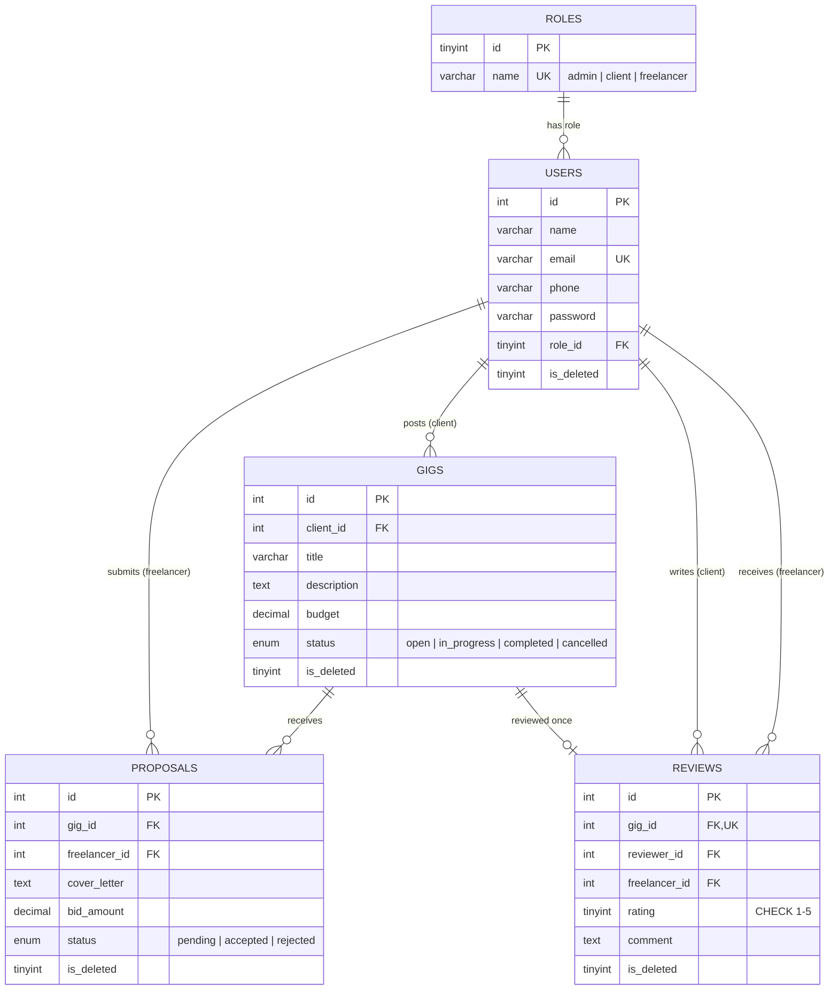

# DevGigs

**A freelance marketplace where clients post software gigs, freelancers bid on them, and completed work earns a public star rating.**

Built with plain **PHP** and **MySQL** (mysqli, prepared statements), with no framework. It's a small project meant to show relational database design, role-based access and secure form handling.


---

## Features

**Clients**
- Post gigs with a title, description and budget
- Review every proposal on a gig, with each freelancer's average rating shown beside their bid
- Accept one proposal, which moves the gig to *in progress* and rejects the other pending bids
- Mark the gig *completed*, then **rate the freelancer 1-5 stars with an optional comment**

**Freelancers**
- Browse and search open gigs, and sort them by newest or budget
- Send one proposal per gig (cover letter and bid)
- Track proposal status from a personal profile
- Build a reputation: average rating, review count and all reviews on a **public profile** (`freelancer.php`)

**Admins**
- Dashboard with platform counts
- Disable users, remove gigs, and **remove reviews** (soft delete)

**All logged-in users**
- Account settings page: change name and phone, and **change password** (current password required)

**General**
- Light and dark theme (saved in a cookie, follows the device by default)
- Responsive layout, keyboard-friendly star rating control

## Gig life cycle

```
open ──(client accepts a proposal)──► in_progress ──(client marks complete)──► completed ──► client reviews freelancer
```

## Database design

Five tables in third normal form. `roles` and `reviews` are the newest additions.



Key constraints:
- `users.role_id` points to `roles.id`. Each account has exactly one role; someone who wants to both hire and work registers two accounts with different emails.
- `proposals (gig_id, freelancer_id)` is unique, so a freelancer bids once per gig.
- `reviews.gig_id` is unique, so there is at most one review per gig.
- `reviews.rating` has a `CHECK (rating BETWEEN 1 AND 5)`. The app validates it too, because MySQL older than 8.0.16 ignores `CHECK`.
- Nothing is hard-deleted. Rows are flagged with `is_deleted`.

Full SQL: [`database/schema.sql`](database/schema.sql)

## Security

- Prepared statements for every query (SQL injection)
- Output escaping with `htmlspecialchars` (XSS), including review text
- Per-session CSRF token on every state-changing form
- Passwords hashed with bcrypt, session id regenerated at login
- HttpOnly, SameSite session cookie (Secure on HTTPS)
- Role and ownership checked on the server for every action; roles live in a `roles` table and are re-read from the database on every protected request
- Hiring runs in a database transaction with row locks

## Getting started

**Requirements:** PHP 7.4+ with `mysqli`, and MySQL 8.0.16+ or MariaDB 10.2+. XAMPP works.

```bash
# 1. Create the database and a user (adjust names/password as you like)
mysql -u root -p -e "CREATE DATABASE devdb;
  CREATE USER 'devuser'@'localhost' IDENTIFIED BY 'devuser';
  GRANT ALL ON devdb.* TO 'devuser'@'localhost';"

# 2. Load the schema (safe to re-run: uses CREATE TABLE IF NOT EXISTS)
mysql -u devuser -p devdb < database/schema.sql

# 3. Check the credentials in config/database.php

# 4. Start the app (serve the public/ folder)
php -S localhost:8000 -t public
```

Open <http://localhost:8000>.

**Create an admin.** Admins can't be created from the sign-up form. Sign up normally, then run:

```sql
UPDATE users SET role_id = (SELECT id FROM roles WHERE name = 'admin') WHERE email = 'you@example.com';
```

**Forgot the admin password?** There is no email reset in this MVP. Run `php database/set_password.php admin@example.com` and type the new password at the prompt.

**Upgrading an existing database?** Run `database/migrate_roles.sql` once (moves the old `users.role` column into the `roles` table, keeping your data), and the `CREATE TABLE IF NOT EXISTS reviews ...` statement from `schema.sql`.

## Try the review flow

1. Sign up as a **client** and post a gig.
2. Sign up as a **freelancer** (another browser or private window) and send a proposal.
3. As the client, open the gig, **Accept proposal**, then **Mark as completed**.
4. Leave a star rating. It now shows on the gig, on the proposal list for future gigs, and on the freelancer's public profile.

## Project structure

```
devgigs/
├── config/database.php      mysqli connection ($db): edit credentials here
├── includes/
│   ├── helpers.php          e() escaping, redirect(), star + rating helpers
│   ├── session.php          session start + cookie settings, CSRF token, flash messages
│   ├── auth.php             authentication (login_user, logout_user) and authorization (require_login + roles)
│   ├── cookies.php          cookie preferences: theme, gig sort, remembered email
│   ├── db.php               prepared-statement helpers: db_all, db_one, db_exec
│   ├── validation.php       server-side validation (email, password, phone, text, money, rating)
│   └── layout.php           shared header, nav, footer
├── public/                  web root
│   ├── index.php            home, search and gig list
│   ├── signup.php / login.php / logout.php
│   ├── create-gig.php       client: post a gig
│   ├── view-gig.php         gig details, proposals, accept, complete, review
│   ├── freelancer.php       public freelancer profile with reviews
│   ├── settings.php         change name, phone and password
│   ├── profile.php          own profile (gigs / proposals / reviews)
│   ├── admin-dashboard.php  moderation
│   └── css/ js/ img/
└── database/
    ├── schema.sql           tables and indexes (fresh install)
    ├── migrate_roles.sql    one-time upgrade: users.role column -> roles table
    └── set_password.php     command line: set any user's password (e.g. a forgotten admin password)
```

## Roadmap

- [ ] Freelancer replies to reviews, and two-way reviews
- [ ] Sub-ratings (communication, quality, timeliness)
- [ ] Email notifications and an emailed "forgot password" link
- [ ] Payments / escrow and in-app messaging
- [ ] Gig cancellation

## Documentation

A full Product Requirements Document (functional and non-functional requirements, data model, acceptance criteria) is provided separately as `DevGigs_PRD.docx`.

## Author

**Muhammad Huzaifa Farrukh**: [GitHub](https://github.com/*MuhammadHuzaifaFarrukh) · [LinkedIn](https://linkedin.com/in/your-profile)

