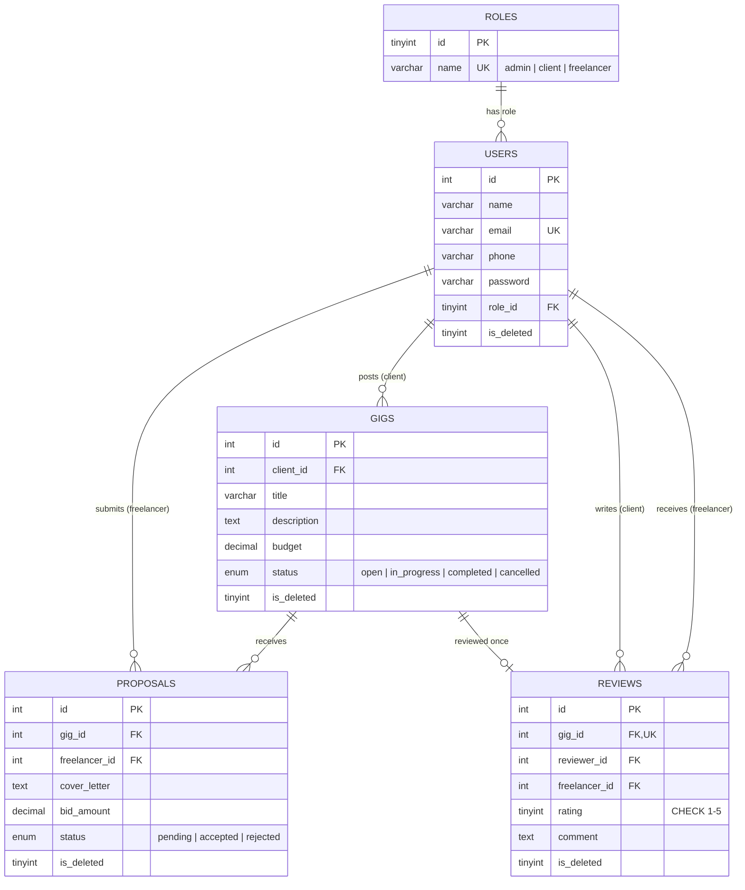

# DevGigs

**A freelance marketplace where clients post software gigs, freelancers bid on them, and completed work earns a public star rating.**

Built with plain **PHP** and **MySQL** (mysqli, prepared statements), with no framework. It's a small project meant to show relational database design, role-based access and secure form handling.


---

## Features

**Guests (not logged in)**
- Browse, search and read gigs and freelancer profiles; nothing else

**Clients**
- Post gigs with a title, description and budget
- **Edit, cancel or delete** their own gigs, and list them with search, status filter and pagination (`my-gigs.php`)
- Review every proposal on a gig, with each freelancer's average rating shown beside their bid
- Accept one proposal, which moves the gig to *in progress* and rejects the other pending bids, or reject proposals one by one
- Mark the gig *completed*, then **rate the freelancer 1-5 stars with an optional comment**
- Edit or delete their own review

**Freelancers**
- Browse and search open gigs, and sort them by newest or budget
- Send one proposal per gig (cover letter and bid), then **edit or withdraw** it while it is pending
- Track every proposal and its status in **My proposals** (`my-proposals.php`) and on a personal profile
- Build a reputation: average rating, review count and all reviews on a **public profile** (`freelancer.php`)

**Admins**
- Dashboard with platform counts, newest records and review moderation
- **Manage users:** list, search and filter everyone, **add a user with any role and a password**, edit any user, disable or restore an account, or **permanently destroy** it
- **Manage gigs:** view every gig (including removed ones), remove or restore (admins do not create or edit gigs)
- **Remove or restore reviews** (soft delete)

**All logged-in users**
- Account settings page: change name and phone, and **change password** (current password required)
- **Delete their own account** (password required; not available to admins)

**General**
- Light and dark theme (saved in a cookie, follows the device by default)
- Responsive layout, keyboard-friendly star rating control

## CRUD operations

Every create, update and delete is a POST request with a CSRF token, validated on the server and run with prepared statements. Every delete shows a confirmation page first. After the first admin exists you never need to open MySQL again.

**Gigs**
- **Create:** client, `create-gig.php`
- **Read:** everyone sees open gigs on `index.php` (paginated, with search and sort); a client lists their own in `my-gigs.php`; an admin sees all, including removed ones, in `admin-gigs.php`
- **Update:** client, own gig, only while it is open, `edit-gig.php`
- **Delete:** client, own gig, while open or cancelled, `delete-gig.php` (soft delete). A client can also **cancel** an open or in-progress gig. An admin removes or restores gigs in `admin-gigs.php`

**Proposals**
- **Create:** freelancer, on an open gig, `view-gig.php`
- **Read:** a freelancer sees their own in `my-proposals.php`; a client sees those on their gig; an admin sees all (read-only)
- **Update:** freelancer, own pending proposal, `edit-proposal.php`; the client **accepts or rejects** on `view-gig.php`
- **Delete:** freelancer **withdraws** their own pending proposal, `delete-proposal.php`

**Reviews**
- **Create:** client, after the gig is completed, `view-gig.php`
- **Read:** public, on the gig and on the freelancer profile
- **Update:** the client who wrote it, `edit-review.php`
- **Delete:** the client who wrote it, `delete-review.php`; an admin removes or restores reviews in `admin-dashboard.php`

**Users**
- **Create:** sign-up as client or freelancer (`signup.php`); an **admin adds any role and sets the password** in `admin-user-form.php`
- **Read:** own profile (`profile.php`), public freelancer profile (`freelancer.php`); an **admin lists, searches and filters everyone** in `admin-users.php`
- **Update:** own name, phone and password in `settings.php`; an **admin edits any user, role and password** in `admin-user-form.php`
- **Delete:** own account in `delete-account.php` (password required); an **admin disables, restores or permanently destroys** accounts in `admin-users.php` and `admin-user-delete.php` (destroying asks for the admin's password)

**Delete rules**
- **Soft delete** (`is_deleted = 1`) keeps the row and can be undone. Used for gigs, reviews removed by an admin, disabled users and deleted accounts.
- **Hard delete** removes the row. Used only for withdrawing a pending proposal, deleting your own review, and an admin destroying an account (which removes that user's reviews, proposals and gigs first, in one transaction).
- Admin accounts cannot be disabled or destroyed through the site, and an admin keeps the admin role, so the platform can never lock itself out.

## Gig life cycle

```
open ──(client accepts a proposal)──► in_progress ──(client marks complete)──► completed ──► client reviews freelancer

open or in_progress ──(client cancels)──► cancelled
```

A gig can be **edited** only while it is open, **cancelled** while it is open or in progress (pending proposals are rejected), and **deleted** while it is open or cancelled.

## Database design

Five tables in third normal form. `roles` and `reviews` are the newest additions.



Key constraints:
- `users.role_id` points to `roles.id`. Each account has exactly one role; someone who wants to both hire and work registers two accounts with different emails.
- `proposals (gig_id, freelancer_id)` is unique, so a freelancer bids once per gig. Withdrawing a proposal deletes the row, so they can bid again.
- `reviews.gig_id` is unique, so there is at most one review per gig.
- `reviews.rating` has a `CHECK (rating BETWEEN 1 AND 5)`. The app validates it too, because MySQL older than 8.0.16 ignores `CHECK`.
- Rows are normally flagged with `is_deleted` instead of being removed. The exceptions are a withdrawn proposal, a review deleted by its author, and an account destroyed by an admin; because of the foreign keys that delete runs children first (reviews, proposals, gigs, then the user).

Full SQL: [`database/schema.sql`](database/schema.sql)

## Security

- Prepared statements for every query (SQL injection)
- Output escaping with `htmlspecialchars` (XSS), including review text
- Per-session CSRF token on every state-changing form, including every delete
- Confirmation page before every delete; destroying a user also asks for the admin's password
- Passwords hashed with bcrypt, session id regenerated at login
- HttpOnly, SameSite session cookie (Secure on HTTPS)
- Role and ownership checked on the server for every action; roles live in a `roles` table and are re-read from the database on every protected request
- Hiring, cancelling and destroying an account run in database transactions
- Search, sort, filter and page values from the URL are checked against whitelists

## Getting started

**Requirements:** PHP 7.4+ with `mysqli`, and MySQL 8.0.16+ or MariaDB 10.2+. XAMPP works.

```bash
# 1. Create the database and a user (adjust names/password as you like)
mysql -u root -p -e "CREATE DATABASE devdb;
  CREATE USER 'devuser'@'localhost' IDENTIFIED BY 'devuser';
  GRANT ALL ON devdb.* TO 'devuser'@'localhost';"

# 2. Load the schema (safe to re-run: uses CREATE TABLE IF NOT EXISTS)
mysql -u devuser -p devdb < database/schema.sql

# 3. Check the credentials in config/database.php

# 4. Start the app (serve the public/ folder)
php -S localhost:8000 -t public
```

Open <http://localhost:8000>.

**Create an admin.** Admins can't be created from the sign-up form. Sign up normally, then run:

```sql
UPDATE users SET role_id = (SELECT id FROM roles WHERE name = 'admin') WHERE email = 'you@example.com';
```

**Create other users.** Log in as the admin and use **Admin > Users > Add user** to create any account (any role) with a password you choose. No more SQL is needed.

**Forgot the admin password?** There is no email reset in this MVP. Run `php database/set_password.php admin@example.com` and type the new password at the prompt.

**Upgrading an existing database?** Run `database/migrate_roles.sql` once (moves the old `users.role` column into the `roles` table, keeping your data), and the `CREATE TABLE IF NOT EXISTS reviews ...` statement from `schema.sql`.

## Try the review flow

1. Sign up as a **client** and post a gig.
2. Sign up as a **freelancer** (another browser or private window) and send a proposal.
3. As the client, open the gig, **Accept proposal**, then **Mark as completed**.
4. Leave a star rating. It now shows on the gig, on the proposal list for future gigs, and on the freelancer's public profile.

## Try the CRUD flow

1. As the freelancer, open **My proposals**, edit the bid, withdraw it, and send a new one.
2. As the client, open **My gigs**, edit a gig, cancel one, and delete one.
3. As the admin, open **Admin > Users**: add a user, change their password, disable and restore them, then destroy a test account.

## Project structure

```
devgigs/
├── config/database.php      mysqli connection ($db): edit credentials here
├── includes/
│   ├── helpers.php          e() escaping, redirect(), star + rating helpers
│   ├── session.php          session start + cookie settings, CSRF token, flash messages
│   ├── auth.php             authentication (login_user, logout_user) and authorization (require_login + roles)
│   ├── cookies.php          cookie preferences: theme, gig sort, remembered email
│   ├── db.php               prepared-statement helpers: db_all, db_one, db_exec
│   ├── validation.php       server-side validation (email, password, phone, text, money, rating)
│   ├── lists.php            search term, choice() whitelist, pagination
│   ├── users.php            user helpers: find_user, role_id_by_name, user_footprint, destroy_user
│   └── layout.php           shared header, nav, footer
├── public/                  web root
│   ├── index.php            home, search and gig list
│   ├── signup.php / login.php / logout.php
│   ├── create-gig.php       client: post a gig
│   ├── my-gigs.php          client: list own gigs (search, filter, pagination)
│   ├── edit-gig.php         client: edit an open gig
│   ├── delete-gig.php       client: delete a gig (confirm page)
│   ├── view-gig.php         gig details, proposals, accept / reject, cancel, complete, review
│   ├── my-proposals.php     freelancer: list own proposals
│   ├── edit-proposal.php    freelancer: edit a pending proposal
│   ├── delete-proposal.php  freelancer: withdraw a pending proposal
│   ├── edit-review.php      client: edit own review
│   ├── delete-review.php    client: delete own review
│   ├── freelancer.php       public freelancer profile with reviews
│   ├── settings.php         change name, phone and password
│   ├── delete-account.php   delete your own account (password required)
│   ├── profile.php          own profile (gigs / proposals / reviews)
│   ├── admin-dashboard.php  overview and review moderation
│   ├── admin-users.php      list, search, disable / restore users
│   ├── admin-user-form.php  add a user (set password) or edit one
│   ├── admin-user-delete.php  permanently destroy a user
│   ├── admin-gigs.php       list all gigs, remove / restore
│   └── css/ js/ img/
└── database/
    ├── schema.sql           tables and indexes (fresh install)
    ├── migrate_roles.sql    one-time upgrade: users.role column -> roles table
    └── set_password.php     command line: set any user's password (e.g. a forgotten admin password)
```

## Roadmap

- [ ] Freelancer replies to reviews, and two-way reviews
- [ ] Sub-ratings (communication, quality, timeliness)
- [ ] Email notifications and an emailed "forgot password" link
- [ ] Payments / escrow and in-app messaging

## Documentation

A full Product Requirements Document (functional and non-functional requirements, data model, acceptance criteria) is provided separately as `DevGigs_PRD.docx`.

## Author

**Muhammad Huzaifa Farrukh**: [GitHub](https://github.com/*MuhammadHuzaifaFarrukh) · [LinkedIn](https://www.linkedin.com/in/muhammad-huzaifa-farrukh-9608a1358/)

