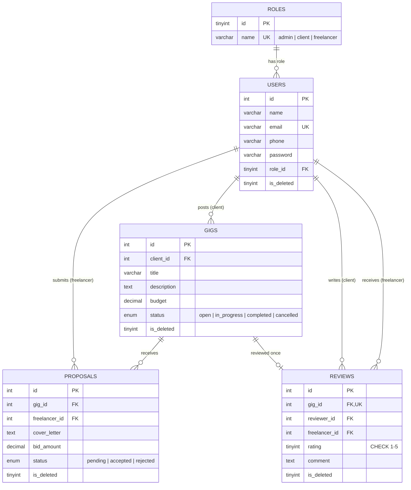

# DevGigs

**A freelance marketplace where clients post software gigs, freelancers bid on them, and completed work earns a public star rating.**

Built with plain **PHP** and **MySQL** (mysqli, prepared statements), with no framework. It's a small project meant to show relational database design, role-based access and secure form handling.


---

## Features

**Guests (not logged in)**
- Browse, search and sort open gigs, and read gig details and freelancer profiles
- Nothing else: they cannot post, bid, review or manage anything

**Clients**
- Post gigs with a title, description and budget, and **edit, cancel or delete** their own gigs
- List all their gigs with search, status filter and pagination (`my-gigs.php`)
- Review every proposal on a gig, with each freelancer's average rating beside their bid
- **Accept** one proposal (the gig moves to *in progress* and the other pending bids are rejected) or **reject** proposals one by one
- Mark the gig *completed*, then **rate the freelancer 1-5 stars with an optional comment**, and edit or delete that review later

**Freelancers**
- Browse and search open gigs, and sort them by newest or budget
- Send one proposal per gig (cover letter and bid), then **edit or withdraw** it while it is pending
- Track every proposal and its status (`my-proposals.php`)
- Build a reputation: average rating, review count and all reviews on a **public profile** (`freelancer.php`)

**Admins** (admins have their own account and do not create or edit gigs)
- Dashboard with platform counts, newest records and review moderation
- **Users:** list, search and filter everyone; **add a user with any role and set their password**; edit name, email, phone, role and password; disable or restore an account; **permanently destroy** an account
- **Gigs:** view every gig (including removed ones), remove or restore
- **Reviews:** remove or restore

**All logged-in users**
- Account settings: change name and phone, change password (current password required), **delete own account** (non-admins)

**General**
- Light and dark theme (saved in a cookie, follows the device by default)
- Pagination, search and filters on every long list
- Responsive layout, keyboard-friendly star rating control

## CRUD at a glance

Every create, update and delete is a **POST with a CSRF token**, validated on the server and run with **prepared statements**. Deletes show a confirmation page first. Once the database exists you never need to open MySQL for day-to-day work.

| Data | Create | Read | Update | Delete |
|---|---|---|---|---|
| **Gigs** | Client: `create-gig.php` | Everyone: open gigs on `index.php` (paginated, search, sort). Client: own gigs in `my-gigs.php`. Admin: all, including removed, in `admin-gigs.php` | Client, own gig, while open: `edit-gig.php` | Client, own gig, while open or cancelled: `delete-gig.php` (soft). Client can also **cancel** an open or in-progress gig. Admin **removes / restores** (soft) |
| **Proposals** | Freelancer, on an open gig: `view-gig.php` | Freelancer: own, in `my-proposals.php`. Client: those on their gig. Admin: all, read-only | Freelancer, own pending proposal: `edit-proposal.php`. Client **accepts / rejects** on `view-gig.php` | Freelancer **withdraws** own pending proposal: `delete-proposal.php` |
| **Reviews** | Client, after the gig is completed: `view-gig.php` | Public, on the gig and the freelancer profile | Author: `edit-review.php` | Author: `delete-review.php`. Admin removes / restores in `admin-dashboard.php` |
| **Users** | Sign up as client or freelancer: `signup.php`. **Admin adds any role and sets the password:** `admin-user-form.php` | Own profile: `profile.php`. Public freelancer profile: `freelancer.php`. **Admin lists everyone:** `admin-users.php` | Own name, phone, password: `settings.php`. **Admin edits any user:** `admin-user-form.php` | Own account: `delete-account.php` (needs password, soft). **Admin disables / restores:** `admin-users.php`. **Admin destroys permanently:** `admin-user-delete.php` (needs the admin's password) |

**Delete rules**
- **Soft delete** (`is_deleted = 1`) keeps the row and can be undone. It is used for gigs, reviews removed by an admin, disabled users and deleted accounts.
- **Hard delete** is used only where nothing else depends on the row: withdrawing a pending proposal, deleting your own review, and an admin destroying an account. Destroying an account removes that user's reviews, proposals and gigs first, in one transaction.
- Admin accounts cannot be disabled or destroyed through the site, and an admin keeps the admin role, so the platform can never lock itself out.

=======
**Clients**
- Post gigs with a title, description and budget
- Review every proposal on a gig, with each freelancer's average rating shown beside their bid
- Accept one proposal, which moves the gig to *in progress* and rejects the other pending bids
- Mark the gig *completed*, then **rate the freelancer 1-5 stars with an optional comment**

**Freelancers**
- Browse and search open gigs, and sort them by newest or budget
- Send one proposal per gig (cover letter and bid)
- Track proposal status from a personal profile
- Build a reputation: average rating, review count and all reviews on a **public profile** (`freelancer.php`)

**Admins**
- Dashboard with platform counts
- Disable users, remove gigs, and **remove reviews** (soft delete)

**All logged-in users**
- Account settings page: change name and phone, and **change password** (current password required)

**General**
- Light and dark theme (saved in a cookie, follows the device by default)
- Responsive layout, keyboard-friendly star rating control

## Gig life cycle

```
open ──(client accepts a proposal)──► in_progress ──(client marks complete)──► completed ──► client reviews freelancer
<<<<<<< HEAD
  │                                        │
  └──────────(client cancels)──────────────┴──► cancelled
```

- **Edit** is allowed only while a gig is *open*.
- **Delete** is allowed only while a gig is *open* or *cancelled*.
- **Cancel** is allowed while a gig is *open* or *in progress*; pending proposals are rejected.

## Database design

Five tables in third normal form.
=======
```

## Database design

Five tables in third normal form. `roles` and `reviews` are the newest additions.



Key constraints:
- `users.role_id` points to `roles.id`. Each account has exactly one role; someone who wants to both hire and work registers two accounts with different emails.

- `proposals (gig_id, freelancer_id)` is unique, so a freelancer bids once per gig. Withdrawing a proposal is a real `DELETE`, which frees the slot so they can bid again.
- `reviews.gig_id` is unique, so there is at most one review per gig. An author who deletes their own review can write a new one; an admin-removed review stays blocked.
- `reviews.rating` has a `CHECK (rating BETWEEN 1 AND 5)`. The app validates it too, because MySQL older than 8.0.16 ignores `CHECK`.
- Foreign keys forbid deleting a parent before its children, so permanently destroying a user deletes in the order reviews, proposals, gigs, user.
=======
- `proposals (gig_id, freelancer_id)` is unique, so a freelancer bids once per gig.
- `reviews.gig_id` is unique, so there is at most one review per gig.
- `reviews.rating` has a `CHECK (rating BETWEEN 1 AND 5)`. The app validates it too, because MySQL older than 8.0.16 ignores `CHECK`.
- Nothing is hard-deleted. Rows are flagged with `is_deleted`.

Full SQL: [`database/schema.sql`](database/schema.sql)

## Security

- Prepared statements for every query (SQL injection)

- Output escaping with `htmlspecialchars` (XSS), including review text and gig titles
- Per-session CSRF token on every state-changing form, including every delete
- Confirmation page before every delete; permanent user deletion also asks for the admin's password
- Passwords hashed with `password_hash()` (bcrypt); session id regenerated at login
- HttpOnly, SameSite session cookie (Secure on HTTPS)
- Role and ownership checked on the server for every action (the `WHERE` clause of each update repeats the check); roles live in a `roles` table and are re-read from the database on every protected request
- Search, sort, status and page values from the URL are checked against whitelists
- Hiring and cancelling run in database transactions
=======
- Output escaping with `htmlspecialchars` (XSS), including review text
- Per-session CSRF token on every state-changing form
- Passwords hashed with bcrypt, session id regenerated at login
- HttpOnly, SameSite session cookie (Secure on HTTPS)
- Role and ownership checked on the server for every action; roles live in a `roles` table and are re-read from the database on every protected request
- Hiring runs in a database transaction with row locks


## Getting started

**Requirements:** PHP 7.4+ with `mysqli`, and MySQL 8.0.16+ or MariaDB 10.2+. XAMPP works.

```bash
# 1. Create the database and a user (adjust names/password as you like)
mysql -u root -p -e "CREATE DATABASE devdb;
  CREATE USER 'devuser'@'localhost' IDENTIFIED BY 'devuser';
  GRANT ALL ON devdb.* TO 'devuser'@'localhost';"

# 2. Load the schema (safe to re-run: uses CREATE TABLE IF NOT EXISTS)
mysql -u devuser -p devdb < database/schema.sql

# 3. Check the credentials in config/database.php

# 4. Start the app (serve the public/ folder)
php -S localhost:8000 -t public
```

Open <http://localhost:8000>.


**Create the first admin.** The sign-up form only offers client and freelancer. Sign up normally, then run this once:
=======
**Create an admin.** Admins can't be created from the sign-up form. Sign up normally, then run:


```sql
UPDATE users SET role_id = (SELECT id FROM roles WHERE name = 'admin') WHERE email = 'you@example.com';
```


After that, log in as the admin and create every other account (any role, with a password you choose) from **Admin > Users > Add user**. No more SQL is needed.

**Forgot the admin password?** There is no email reset in this MVP. Run `php database/set_password.php admin@example.com` and type the new password at the prompt.

## Try it out

**Review flow**
1. Sign up as a **client** and post a gig.
2. Sign up as a **freelancer** (another browser or private window) and send a proposal.
3. As the client, open the gig, **Accept proposal**, then **Mark as completed**.
4. Leave a star rating. It now shows on the gig, beside the freelancer's future bids, and on their public profile.

**CRUD flow**
1. As the freelancer, open **My proposals**, edit the bid, withdraw it, and send a new one.
2. As the client, open **My gigs**, edit a gig, cancel one, delete one.
3. As the admin, open **Admin > Users**, add a user, reset their password, disable and restore them, then destroy a test account.
=======
**Forgot the admin password?** There is no email reset in this MVP. Run `php database/set_password.php admin@example.com` and type the new password at the prompt.

**Upgrading an existing database?** Run `database/migrate_roles.sql` once (moves the old `users.role` column into the `roles` table, keeping your data), and the `CREATE TABLE IF NOT EXISTS reviews ...` statement from `schema.sql`.

## Try the review flow

1. Sign up as a **client** and post a gig.
2. Sign up as a **freelancer** (another browser or private window) and send a proposal.
3. As the client, open the gig, **Accept proposal**, then **Mark as completed**.
4. Leave a star rating. It now shows on the gig, on the proposal list for future gigs, and on the freelancer's public profile.


## Project structure

```

DevGigs/
├── README.md
├── config/
│   └── database.php           mysqli connection ($db): edit credentials here
├── includes/                  shared PHP, never opened directly in the browser
│   ├── helpers.php            e() escaping, redirect(), stars() and freelancer_rating()
│   ├── session.php            session start + cookie settings, CSRF token, flash messages
│   ├── auth.php               login_user, logout_user, require_login (+ role check)
│   ├── cookies.php            cookie preferences: theme, gig sort, remembered email
│   ├── db.php                 prepared-statement helpers: db_all, db_one, db_exec
│   ├── validation.php         server-side validation (email, password, phone, text, money, rating)
│   ├── lists.php              search term, whitelist choice(), pagination (paginate, pager)
│   ├── users.php              user helpers: find_user, role_id_by_name, user_footprint, destroy_user
│   └── layout.php             page_start/page_end, nav, admin_tabs, error_page, footer
├── public/                    web root: serve this folder
│   ├── index.php              home: hero, search, sort and paginated gig list
│   ├── signup.php  login.php  logout.php
│   ├── profile.php            own profile (my gigs / my proposals / reviews)
│   ├── settings.php           change name, phone and password; link to delete account
│   ├── freelancer.php         public freelancer profile with reviews
│   │
│   │   Gigs
│   ├── create-gig.php         client: post a gig
│   ├── view-gig.php           gig details; send / accept / reject proposals; cancel; complete; review
│   ├── my-gigs.php            client: list own gigs (search, filter, pagination)
│   ├── edit-gig.php           client: edit an open gig
│   ├── delete-gig.php         client: delete (confirm page, soft delete)
│   │
│   │   Proposals
│   ├── my-proposals.php       freelancer: list own proposals
│   ├── edit-proposal.php      freelancer: edit a pending proposal
│   ├── delete-proposal.php    freelancer: withdraw a pending proposal
│   │
│   │   Reviews
│   ├── edit-review.php        client: edit own review
│   ├── delete-review.php      client: delete own review
│   │
│   │   Accounts
│   ├── delete-account.php     any non-admin: delete own account (password required)
│   │
│   │   Admin
│   ├── admin-dashboard.php    counts, newest records, review moderation
│   ├── admin-users.php        list, search, filter, disable / restore users
│   ├── admin-user-form.php    add a user (set password) or edit one (role, password)
│   ├── admin-user-delete.php  permanently destroy a user and their data
│   ├── admin-gigs.php         list all gigs, remove / restore
│   │
│   ├── css/style.css          all styles (light and dark theme)
│   ├── js/main.js             theme toggle, form validation, password generator, autosubmit filters
│   └── img/                   hero.jpg and hero.webp (homepage background)
└── database/
    ├── schema.sql             tables and indexes (fresh install)
    └── set_password.php       command line: set any user's password (e.g. a forgotten admin password)
=======
devgigs/
├── config/database.php      mysqli connection ($db): edit credentials here
├── includes/
│   ├── helpers.php          e() escaping, redirect(), star + rating helpers
│   ├── session.php          session start + cookie settings, CSRF token, flash messages
│   ├── auth.php             authentication (login_user, logout_user) and authorization (require_login + roles)
│   ├── cookies.php          cookie preferences: theme, gig sort, remembered email
│   ├── db.php               prepared-statement helpers: db_all, db_one, db_exec
│   ├── validation.php       server-side validation (email, password, phone, text, money, rating)
│   └── layout.php           shared header, nav, footer
├── public/                  web root
│   ├── index.php            home, search and gig list
│   ├── signup.php / login.php / logout.php
│   ├── create-gig.php       client: post a gig
│   ├── view-gig.php         gig details, proposals, accept, complete, review
│   ├── freelancer.php       public freelancer profile with reviews
│   ├── settings.php         change name, phone and password
│   ├── profile.php          own profile (gigs / proposals / reviews)
│   ├── admin-dashboard.php  moderation
│   └── css/ js/ img/
└── database/
    ├── schema.sql           tables and indexes (fresh install)
    ├── migrate_roles.sql    one-time upgrade: users.role column -> roles table
    └── set_password.php     command line: set any user's password (e.g. a forgotten admin password)

```

## Roadmap

- [ ] Freelancer replies to reviews, and two-way reviews
- [ ] Sub-ratings (communication, quality, timeliness)
- [ ] Email notifications and an emailed "forgot password" link
- [ ] Payments / escrow and in-app messaging

=======
- [ ] Gig cancellation


## Documentation

A full Product Requirements Document (functional and non-functional requirements, data model, acceptance criteria) is provided separately as `DevGigs_PRD.docx`.

## Author


**Muhammad Huzaifa Farrukh**: [GitHub](https://github.com/*MuhammadHuzaifaFarrukh) · [LinkedIn](https://www.linkedin.com/in/muhammad-huzaifa-farrukh-9608a1358/)
=======
**Muhammad Huzaifa Farrukh**: [GitHub](https://github.com/*MuhammadHuzaifaFarrukh) · [LinkedIn](https://linkedin.com/in/your-profile)
